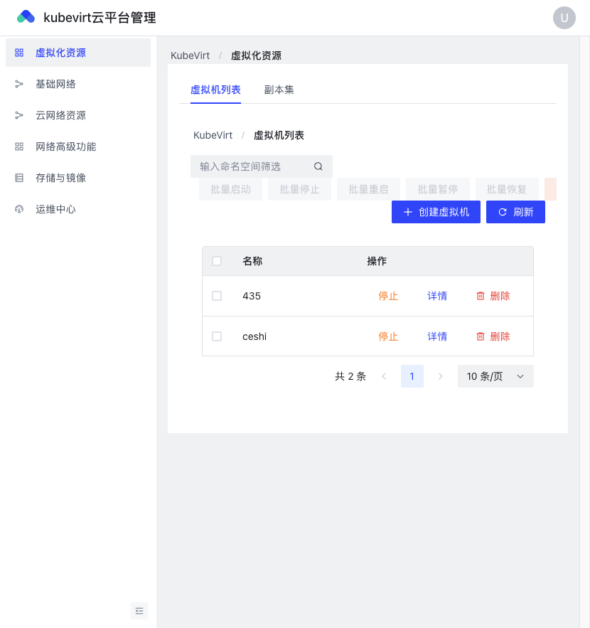
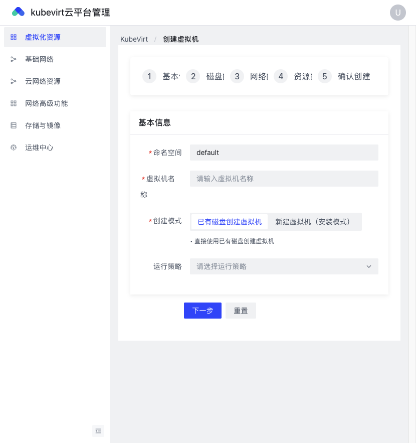
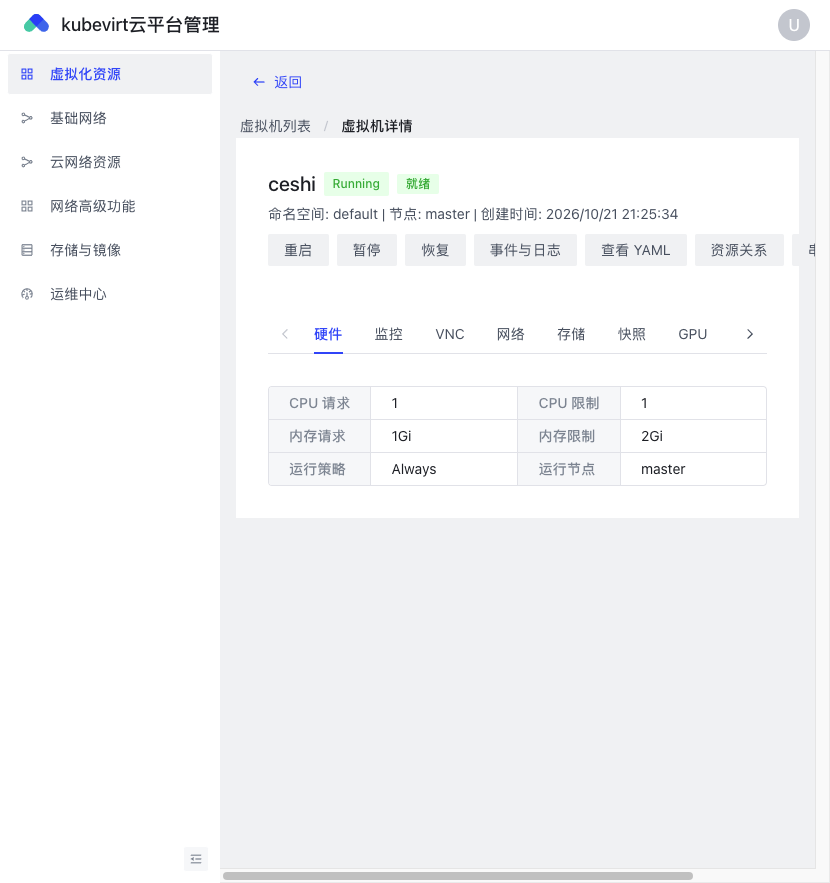
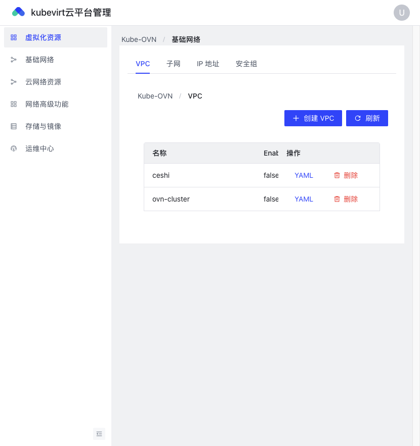
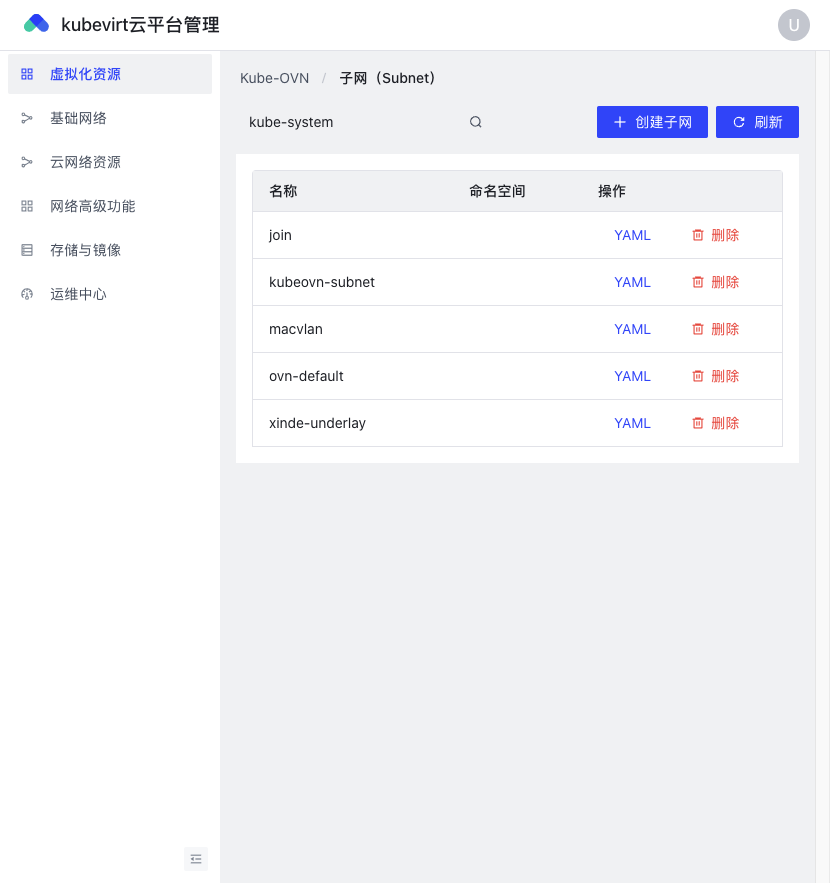
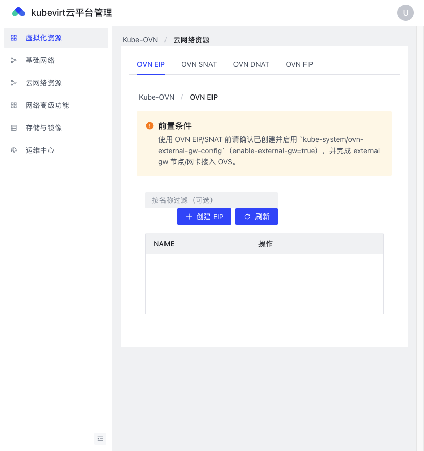
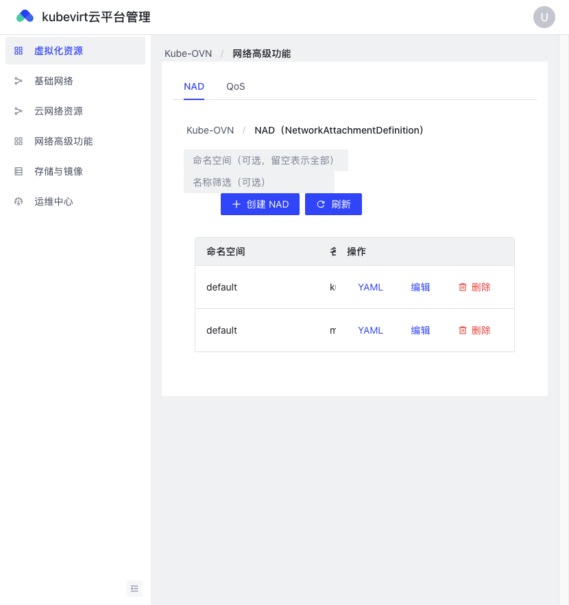
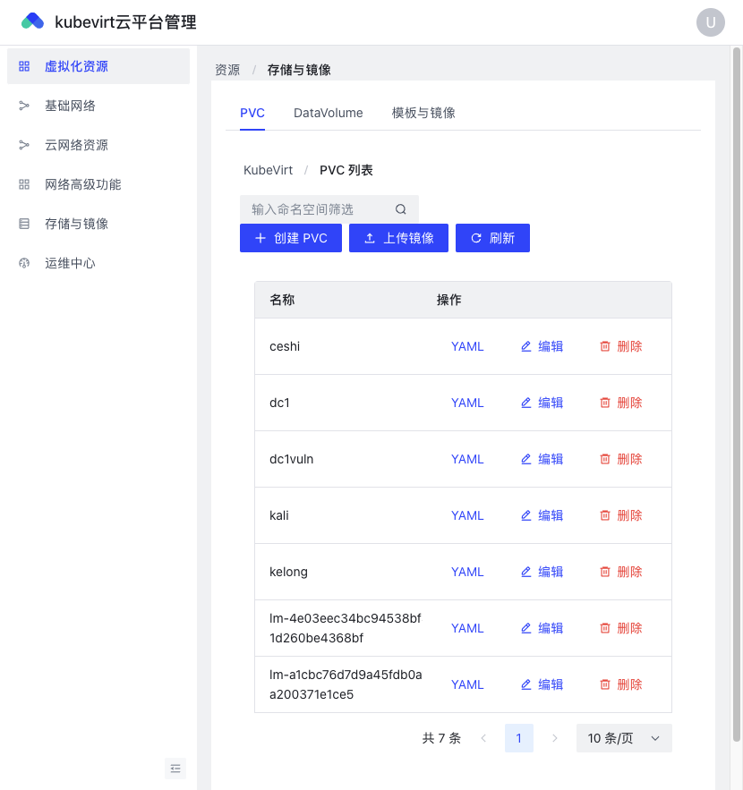
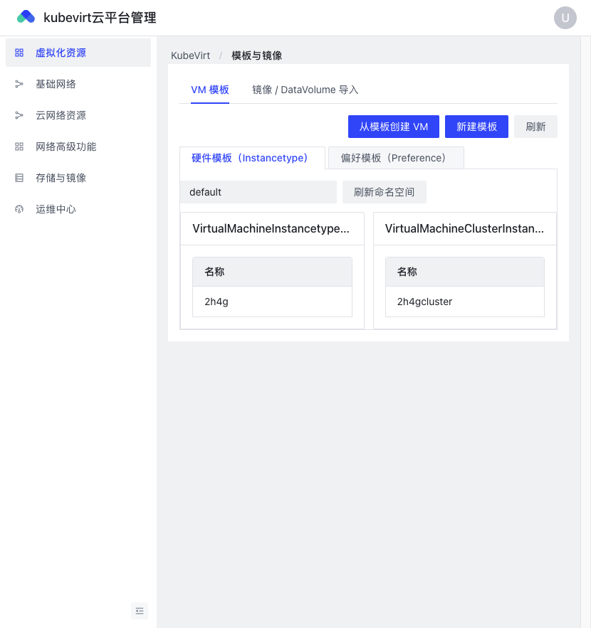
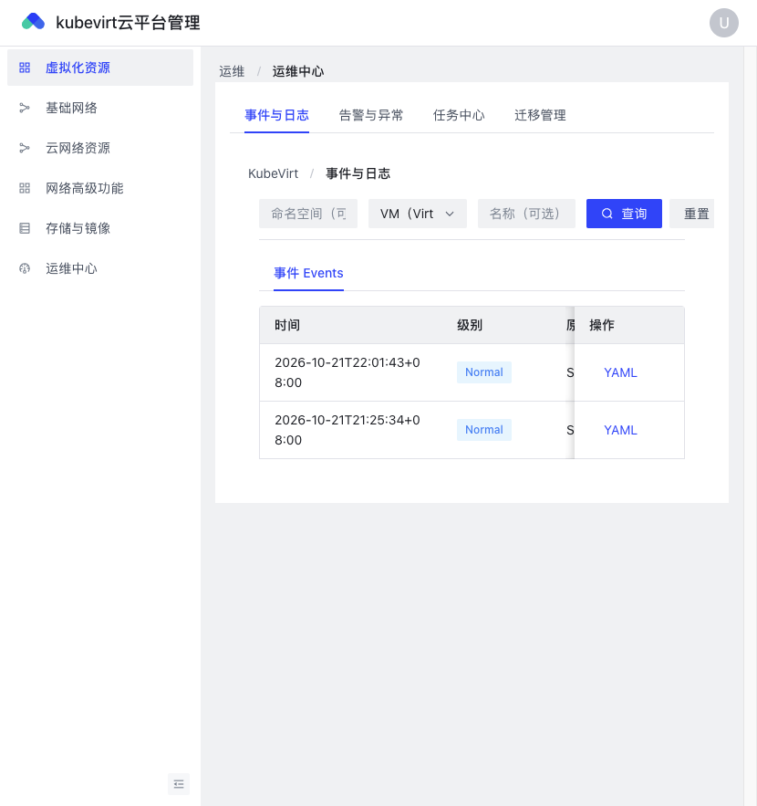

# KubeVirt 面板

面向 KubeVirt 集群的 Web 管理面板。  
比 [kubevirt-manager](https://github.com/kubevirt-manager/kubevirt-manager) 更完整：虚拟机全生命周期 + **Kube-OVN 网络** + 存储镜像 + 运维迁移，一套界面搞定。

> 用镜像部署即可，无需自己编译源码。

---

## 为什么不用 kubevirt-manager？

| | kubevirt-manager | **KubeVirt 面板** |
|--|--|--|
| 虚拟机创建 / 启停 / VNC | ✅ | ✅ |
| 硬件模板 / Preference | 有限 | ✅ Instancetype + Preference |
| Kube-OVN VPC / 子网 / NAD | ❌ | ✅ |
| EIP / SNAT / DNAT / FIP | ❌ | ✅ |
| PVC / DataVolume / 镜像导入 | 基础 | ✅ 含上传与模板 |
| 事件、告警、热迁移 | 弱 | ✅ 运维中心 |

适合已经在用（或准备用）**KubeVirt + Kube-OVN** 的环境，不想再为网络/存储另开一套工具。

---

## 能力概览

- **虚拟机**：列表、向导创建、详情、重启/暂停、VNC、YAML、资源关系  
- **网络**：VPC、子网、IP、安全组、NAD、QoS、EIP/SNAT/DNAT/FIP  
- **存储**：PVC、DataVolume、模板与镜像导入  
- **运维**：事件日志、告警、任务、热迁移  

---

## 界面预览

### 登录


### 虚拟机列表



### 创建虚拟机



### 虚拟机详情



### VPC / 基础网络



### 子网



### 云网络（EIP 等）



### NAD / 高级网络



### 存储与 PVC



### 硬件模板



### 运维 · 事件



---

## 快速开始

依赖：Kubernetes、[KubeVirt](https://kubevirt.io/)、可选 [Kube-OVN](https://github.com/kubeovn/kube-ovn) / Multus。

镜像发布后（Docker Hub / 阿里云）：

```bash
# Docker Hub（待发布）
docker pull docker.io/<namespace>/kubevirt-panel:latest

# 阿里云 ACR（待发布）
docker pull registry.cn-hangzhou.aliyuncs.com/<namespace>/kubevirt-panel:latest
```

默认账号：`admin`（密码以你部署时的配置为准）。

---

## 联系方式

微信 / 联系：**rz1433**

---

## 仓库说明

本仓库提供产品说明与界面截图，方便对比选型。  
业务代码通过容器镜像分发，不在此开源。
